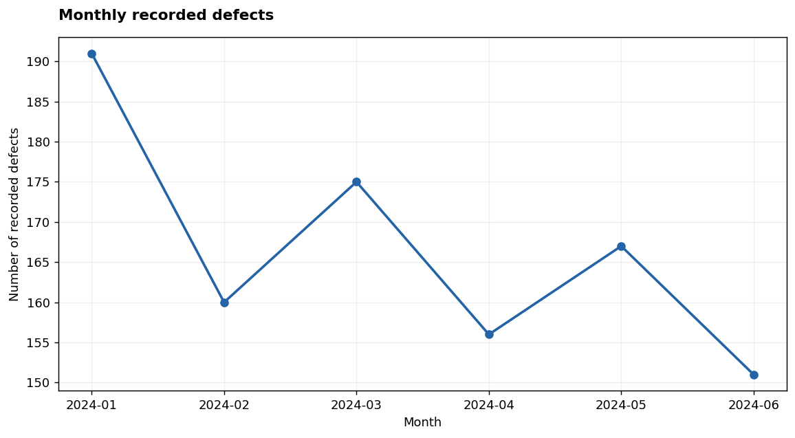
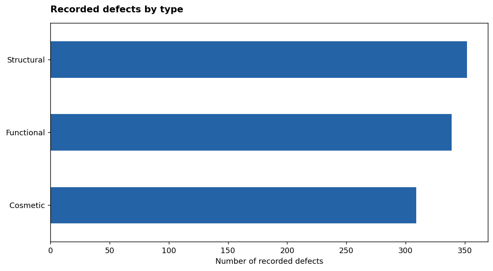
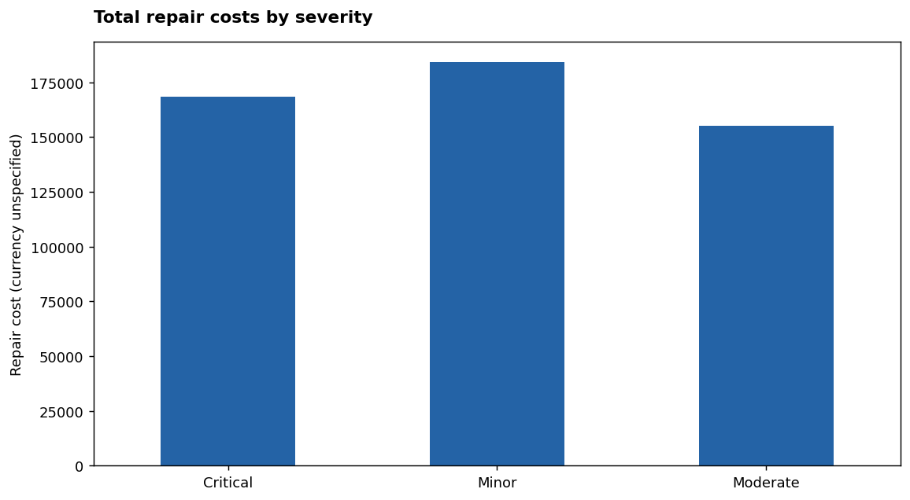
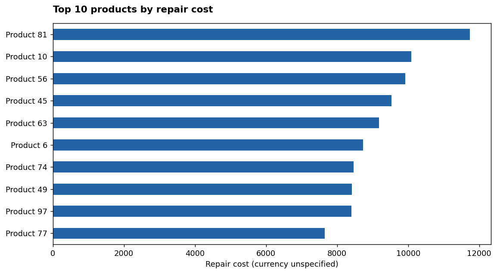

# Manufacturing Quality Intelligence

### SQL Analysis of Manufacturing Defects, Repair Costs, and Inspection Records

**Stack:** MySQL 8.0+, MySQL Workbench, SQL, Git/GitHub; Python used for independent CSV summaries and visualizations.  
**Source:** [Manufacturing Defects — Kaggle](https://www.kaggle.com/datasets/fahmidachowdhury/manufacturing-defects)  
**Project status:** Reproducible SQL and source-derived summaries prepared; run and verify queries in MySQL Workbench before claiming execution there.

## Executive summary

A manufacturing company needs to understand where recorded defects and repair costs concentrate. This portfolio project builds a MySQL database using explicit `INSERT` statements and answers ten quality-control questions using aggregations, conditional logic, CTEs, and window functions.

**Dataset-verified highlights:** **1,000** defect records, **100** distinct product IDs, **507,627.15** in total recorded repair costs (currency unspecified), covering **2024-01-01–2024-06-30**.

## Business problem

Which recorded defect categories, products, locations and periods contribute most to repair costs, and where should quality teams investigate first?

## Objectives

- Describe the distribution and severity of recorded defects.
- Identify the largest contributors to repair expenditure.
- Analyze monthly changes and recurring product defect records.
- Flag high-cost cases for investigation.
- Translate SQL outputs into business recommendations, with clear limitations.

## Dataset and scope

- **1,000** records, **8** columns, **100** distinct product IDs.
- **Grain:** one row per defect record, not one manufactured product.
- **Time:** January through June 2024.
- Full field definitions: [Data dictionary](data_dictionary.md).
- Dataset usage: verify the original dataset license/redistribution terms before publishing `data/defects_data.csv` publicly. If redistribution is not permitted, remove the CSV and link to Kaggle; the SQL insertion script also contains the data, so review that file's redistribution status too.

## Skills demonstrated

`CREATE DATABASE`, `CREATE TABLE`, `INSERT`, primary key, `CHECK`, data validation, `GROUP BY`, `HAVING`, `CASE`, `DATE_FORMAT`, CTEs, `LAG`, `DENSE_RANK`, window `AVG`, views, `LEFT JOIN`, indexing and `EXPLAIN ANALYZE`.

## Questions answered

See [the ten business questions](business_questions.md) and [analysis SQL](03_business_analysis.sql).

## How to reproduce in MySQL Workbench

1. Install **MySQL Server 8.0+** and **MySQL Workbench**, and connect Workbench to your server.
2. Open `sql/01_create_and_populate.sql` and run the entire script. This creates `manufacturing_quality`, defines `manufacturing_defects`, and inserts all 1,000 records **without a CSV import wizard**.
3. Run `sql/02_data_quality.sql` to validate the load.
4. Run `sql/03_business_analysis.sql` to answer Q1–Q10.
5. Optionally run `sql/04_advanced_sql.sql` to create views, demonstrate a join, and inspect query plans.
6. Verify `SELECT COUNT(*) FROM manufacturing_quality.manufacturing_defects;` returns **1,000** and total repair cost equals **507,627.15**.

**Important:** Re-running the insert script on an already populated table will produce duplicate primary-key errors. To restart from scratch, carefully drop the project database first (only if safe to do so), then rerun the setup.

## Results

The following summaries were calculated from the supplied CSV and are provided for cross-validation with the MySQL results:

| Metric | Result |
|---|---:|
| Recorded defects | 1,000 |
| Distinct product IDs | 100 |
| Total recorded repair cost | 507,627.15 |
| Average cost per defect | 507.63 |
| Largest cost-contributing defect type | Structural |
| Highest-cost product | Product 81 |
| Month with most defect records | 2024-01 |

Detailed interpretations: [Analysis summary](analysis_summary.md).

## Visualizations

### Recorded defects by type

### Repair costs by severity

### Ten products with highest repair costs

## Business recommendations

1. Prioritize investigation of **Structural** repair-cost drivers.
2. Examine recurring issues affecting **Product 81**.
3. Review production and quality logs for **2024-01**, when defect records peaked.
4. Obtain production volumes and inspection totals before calculating true defect rates or comparing inspection effectiveness.

## Limitations

This file contains **recorded defects only**. It cannot support a true defect rate per unit produced, inspection sensitivity, or causal conclusions. Multiple records may refer to one product ID. Repair currency is unspecified. Cost-based priorities are investigative hypotheses, not proven causes.

## Author

**Adaeze Obasi** - Data Analyst

## Credits

Dataset: [Manufacturing Defects by fahmidachowdhury on Kaggle](https://www.kaggle.com/datasets/fahmidachowdhury/manufacturing-defects). Original dataset rights remain with its provider.
